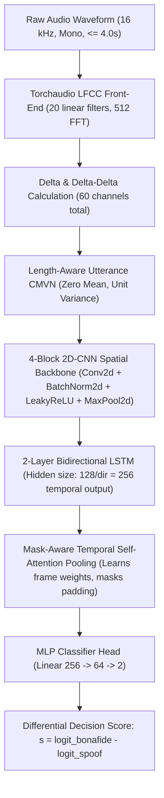

# VoiceShield — Machine Learning (VoiceShield-ML)

> **Offline-First Deepfake Speech Detection & Voice Anti-Spoofing**  
> *Custom LFCC-CMVN-CNN-BiLSTM-Attention Neural Architecture*

---

## 1. What VoiceShield Does & Why We Built It

**VoiceShield** is an offline-first speech anti-spoofing engine designed to distinguish genuine human voices from AI-synthesized speech (Text-to-Speech) and voice-converted speech (VC). 

### The Problem
Generative voice synthesis and neural voice cloning allow malicious actors to impersonate voices with unprecedented fidelity, enabling financial fraud, executive impersonation, and social engineering scams. Most commercial detection solutions rely on cloud-hosted foundation models (e.g. Wav2Vec2, XLS-R) with hundreds of millions of parameters. Cloud-based detection introduces severe user privacy risks, vulnerability to network outages, and latency bottlenecks.

### The VoiceShield Solution
VoiceShield was engineered to run **entirely on-device (offline)** on mobile hardware (such as Android devices via React Native + Expo). We developed and trained a fully custom, lightweight neural network from scratch—rejecting massive multi-gigabyte pretrained foundation models in favor of a specialized **1.74M-parameter architecture** (~6.95 MB FP32 weights) that executes inference in under 11 ms.

---

## 2. Model Architecture: LFCC-CMVN-CNN-BiLSTM-Attention

Our selected model (**VoiceShield CMVN V2**) consists of five stages:



### Architectural Specifications:
1. **Acoustic Front-End (LFCC)**:
   - Uses linear filterbanks (20 filters) instead of Mel filterbanks, because synthetic vocoders leave high-frequency phase and spectral artifacts where Mel filters down-sample resolution.
   - Computes static (20) + velocity $\Delta$ (20) + acceleration $\Delta\Delta$ (20) = 60 cepstral coefficients.
2. **Utterance-Level CMVN**:
   - Applies Cepstral Mean and Variance Normalization across all 60 channels after delta extraction.
   - Standardizes channel dynamic range $(\mu = 0.0, \sigma = 1.0)$ and strips static vocoder spectral tilt and transmission channel bias.
   - Length-aware masking ensures that zero-padded frames are excluded from statistics and remain strictly $0.00000000$.
3. **2D-CNN Spatial Backbone**:
   - 4 convolutional blocks with channels `[32, 64, 128, 256]`, kernel size $3 \times 3$, `BatchNorm2d`, `LeakyReLU(0.2)`, and `MaxPool2d(2, 2)`.
   - Downsamples temporal resolution by 16x and frequency bins from 60 to 3.
4. **Bidirectional LSTM**:
   - 2-layer BiLSTM (128 hidden units per direction $\implies 256$ dimensions).
   - Models long-range temporal co-articulation dynamics across speech frames.
5. **Temporal Attention Pooling**:
   - Computes frame-level attention energy $e_t = v^T \tanh(W h_t + b)$ with softmax masking for padded frames, pooling the temporal sequence into a 256-dimensional context vector.
6. **Binary Classification Head**:
   - Multi-layer perceptron: `Linear(256, 64) -> LeakyReLU(0.2) -> Dropout(0.5) -> Linear(64, 2)`.
   - Logit 0: Spoof / Synthetic | Logit 1: Genuine Human Speech.

---

## 3. Training & Evaluation Methodology

### Dataset
Trained strictly from scratch on the **ASVspoof 2019 Logical Access (LA)** benchmark:
- **Training Set**: 25,380 trials (2,580 Bonafide, 22,800 Spoof across attacks A01–A06).
- **Development Set**: 24,844 trials (2,548 Bonafide, 22,296 Spoof across attacks A01–A06).
- **Held-Out Evaluation Set**: 71,237 trials (7,355 Bonafide, 63,882 Spoof across unseen attacks A07–A19).
- **Strict Data Isolation**: Zero evaluation audio or labels were accessed during training, model selection, or threshold calibration.

### Training Configuration
- **Total Parameters**: 1,736,706 (100% randomly initialized, zero pretrained checkpoints loaded).
- **Batch Size**: 32 | **Optimizer**: AdamW ($\text{lr} = 10^{-4}, \text{weight\_decay} = 10^{-4}$).
- **Scheduler**: CosineAnnealingLR ($T_{\max}=20$) | **Precision**: Mixed Precision (FP16 AMP).
- **Loss**: Class-weighted Cross-Entropy (Spoof: 0.5566, Bonafide: 4.9186).
- **Early Stopping**: Patience = 5 epochs on Development EER.
- **Hardware**: NVIDIA GeForce RTX 4050 Laptop GPU.

---

## 4. Benchmark Performance & Results

### Held-Out Evaluation on ASVspoof 2019 LA (71,237 Trials)

| Metric | V1 Baseline (Raw LFCC) | V2 Selected Model (CMVN) | Delta ($\Delta$) | Status |
|---|:---:|:---:|:---:|:---:|
| **Front-End Preprocessing** | Unnormalized LFCC | **Utterance CMVN** | Experimental Variable | Normalized |
| **Model Checkpoint** | `experiments/custom_lfcc_v1/best_model.pt` | `experiments/custom_lfcc_cmvn_v1/best_model.pt` | — | Epoch 3 Best |
| **Dev Threshold ($\tau_{\text{dev}}$)** | $+11.875000$ | $\mathbf{-2.417969}$ | $-14.293$ | Centered near 0 |
| **Evaluation EER (Interpolated)** | **9.341%** | $\mathbf{8.736\%}$ | $\mathbf{-0.605\%}$ | **+6.5% error reduction** |
| **Area Under ROC (ROC-AUC)** | 0.96830 | 0.96327 | $-0.00503$ | Consistent |
| **Accuracy (at $\tau_{\text{dev}}$)** | 83.468% | $\mathbf{85.698\%}$ | $\mathbf{+2.230\%}$ | **+1,589 net correct** |
| **False Acceptance Rate (FAR)** | 18.337% | $\mathbf{15.660\%}$ | $\mathbf{-2.677\%}$ | **1,710 fewer leaks** |
| **Total False Acceptances** | 11,714 | $\mathbf{10,004}$ | $\mathbf{-1,710}$ | $10,004 / 63,882$ |
| **False Rejection Rate (FRR)** | 0.857% | 2.502% | $+1.645\%$ | $184 / 7,355$ |
| **F1 Score** | 55.324% | $\mathbf{58.467\%}$ | $\mathbf{+3.143\%}$ | Balanced metric gain |
| **Precision** | 38.367% | $\mathbf{41.753\%}$ | $\mathbf{+3.386\%}$ | Improved purity |
| **Recall / Sensitivity** | 99.143% | 97.498% | $-1.645\%$ | High genuine recall |

### Attack-Specific Detection Breakdown (A07 through A19):
- **Generalizing Attacks (A07–A16)**: **99.6% average rejection** (near-perfect defense against conventional neural and concatenative vocoders).
- **A13 (Unseen TTS + Vocoder)**: Errors dropped by **81%** (from 239 down to 46 false acceptances).
- **A19 (Transfer-Learning Vocoder)**: Rejection improved from **53.74% to 65.98%** (+12.2%), with mean score shifting into negative spoof territory ($-3.42$).
- **A17 (Direct Waveform Filtering)**: Rejection nearly doubled from **10.81% to 19.86%** (+9.1%).
- **A18 (CycleGAN Voice Conversion)**: Rejection increased by **5.1x** from **2.81% to 14.45%** (+11.6%).

---

## 5. Known Limitations & Research Transparency

VoiceShield is an active research project. We do **not** claim 100% production readiness or infallible detection:
1. **The CycleGAN & Waveform Filter Frontier (A17 & A18)**:
   A17 (waveform filtering) and A18 (CycleGAN voice conversion) evade linear LFCC detection at high rates (80.14% error on A17; 85.55% error on A18). Because CycleGAN transforms speech between two real human recordings, its articulatory transitions are physically smooth, mimicking natural human vocal tract dynamics. Linear filterbanks lack the geometric low-frequency resolution to capture micro-prosodic pitch and formant perturbations.
2. **Planned Solution**:
   Our roadmap focuses on a **Dual-Branch LFCC + CQCC (Constant Q Cepstral Coefficients)** front-end to capture pitch-synchronous harmonic fine structure.

---

## 6. Quick Start & Inference Workflow

### Installation

```bash
# Clone the repository
git clone https://github.com/rakshita295/VoiceShield.git
cd VoiceShield-ML

# Create virtual environment and install dependencies
python -m venv .venv
source .venv/bin/activate  # On Windows: .venv\Scripts\activate
pip install -r requirements.txt
```

### Running Inference on Audio Files

Evaluate single or multiple audio files using the trained V2 model:

```powershell
python src/inference/predict_lfcc.py --checkpoint experiments/custom_lfcc_cmvn_v1/best_model.pt datasets/samples/genuine_human.wav datasets/samples/synthetic_ai.wav
```

### Running Unit Tests

Execute the complete 18-test unit verification suite:

```powershell
pytest tests -v
```

---

## 7. Mobile Integration (React Native + Expo)

VoiceShield-ML is designed for direct integration with Rakshita's mobile client ([https://github.com/rakshita295/VoiceShield](https://github.com/rakshita295/VoiceShield)), built with **React Native 0.88** and **Expo SDK 58**.

### Planned Mobile Pipeline:
```text
Mobile App (React Native / Expo)
    │
    ├── Audio Capture: expo-audio (16 kHz PCM) or expo-document-picker
    │
    ├── Audio Preprocessing & LFCC+CMVN: High-performance native Kotlin module
    │
    ├── Neural Inference: ONNX Runtime Mobile (com.microsoft.onnxruntime)
    │   └── Model: VoiceShield-CMVN-V2.onnx (1.74M parameters, ~6.95 MB)
    │
    └── Decision Rule: Score > -2.417969 => Genuine Human Speech
```

For complete technical specifications, see [docs/mobile_integration_plan.md](file:///c:/Users/manoj/OneDrive/Desktop/VoiceShield/VoiceShield-ML/docs/mobile_integration_plan.md).

---

## 8. Repository Structure

```text
VoiceShield-ML/
├── src/
│   ├── features/
│   │   └── lfcc.py                 # Torchaudio LFCC + Utterance-Level CMVN
│   ├── models/
│   │   └── lfcc_cnn_bilstm.py      # Custom 1.74M LFCC-CNN-BiLSTM-Attention model
│   ├── inference/
│   │   └── predict_lfcc.py         # Production inference engine & CLI
│   ├── datasets/
│   │   └── asvspoof2019.py         # ASVspoof 2019 LA dataset loader & collator
│   ├── preprocessing/
│   │   └── audio.py                # Standalone audio loading & conditioning
│   ├── training/
│   │   ├── train.py                # CLI training entry point
│   │   └── trainer.py              # Full training engine (AMP FP16, metrics, early stopping)
│   └── evaluation/
│       ├── metrics.py              # EER, ROC-AUC, min t-DCF, confusion matrix
│       ├── audit_dev_predictions.py# Development set auditing script
│       └── evaluate_asvspoof2019_eval.py # Official held-out evaluation runner
│
├── experiments/
│   ├── custom_lfcc_v1/             # V1 Baseline (Epoch 10, EER: 9.341%)
│   └── custom_lfcc_cmvn_v1/        # V2 Selected Model (Epoch 3, EER: 8.736%)
│
├── tests/
│   ├── test_cmvn.py                # 8 CMVN normalization & gradient flow unit tests
│   ├── test_lfcc_model.py          # 6 custom model & collator unit tests
│   └── test_evaluation.py          # 4 metric calculation unit tests
│
├── docs/                           # Technical reports, audits, and integration plans
├── datasets/samples/               # Reference audio clips for testing
├── requirements.txt
├── README.md
└── .gitignore
```
