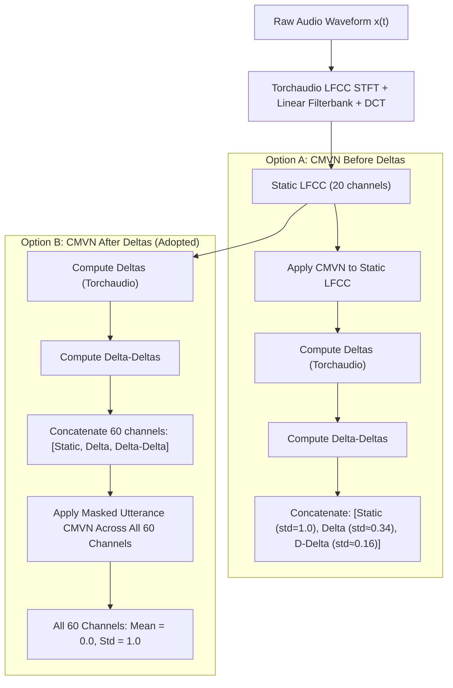

# VoiceShield — Experiment 1: Utterance-Level Cepstral Mean & Variance Normalization (CMVN)

**Document Version:** 1.0  
**Date:** November 17, 2026  
**Status:** Implementation & Unit Testing Complete (Awaiting Training Approval)  
**Target Checkpoint Directory:** `experiments/custom_lfcc_cmvn_v1/`  
**Baseline Model:** `experiments/custom_lfcc_v1/best_model.pt` (V1 Baseline, Untouched)  

---

## 1. Executive Summary & Objective

Following the forensic failure mode analysis of our custom V1 deepfake speech detector ([docs/failure_analysis_v1.md](file:///c:/Users/manoj/OneDrive/Desktop/VoiceShield/VoiceShield-ML/docs/failure_analysis_v1.md)), **Experiment 1** evaluates whether implementing **Utterance-Level Cepstral Mean and Variance Normalization (CMVN)** on the LFCC front-end improves generalization against unseen synthetic speech attacks (specifically A17, A18, and A19) while mitigating acoustic and channel variations.

### Core Objectives
1. **Channel Distortion Invariance**: Eliminate linear time-invariant (LTI) transmission channel biases and stationary spectral tilt in the cepstral domain.
2. **Channel-Scale Equalization**: Balance the dynamic range across all 60 cepstral feature channels (20 static, 20 $\Delta$ velocity, 20 $\Delta\Delta$ acceleration) so that 2D-CNN feature maps receive balanced numerical activations.
3. **Strict Baseline Preservation**: Keep the V1 baseline checkpoint, its saved configuration, and its evaluation artifacts completely untouched.
4. **Leakage-Free Variable-Length Masking**: Guarantee that padding frames in variable-length batches never corrupt valid cepstral statistics and remain strictly zeroed out.

---

## 2. Technical Formulation of Utterance-Level CMVN

### 2.1 Mathematical Definition

In the cepstral domain, an acoustic recording $x(t)$ filtered through a stationary transmission channel $h(t)$ undergoes convolutional distortion:
$$y(t) = x(t) * h(t)$$

Taking the discrete Fourier transform and calculating the logarithm of linear filterbank energies transforms convolution into addition:
$$\log |Y(f)| = \log |X(f)| + \log |H(f)|$$

Applying the Discrete Cosine Transform (DCT-II) yields additive channel offsets in the cepstral coefficients:
$$c_{y, t} = c_{x, t} + c_{h}$$

Because the channel cepstrum $c_h$ is stationary across the duration of an utterance, subtracting the sample mean over the utterance cancels the channel offset:
$$\mu_{i, c} = \frac{1}{T_i} \sum_{t=1}^{T_i} c_{i, c, t} \implies c_{i, c, t} - \mu_{i, c} \approx c_{x, i, c, t} - \mu_{x, i, c}$$

Variance normalization further standardizes the signal dynamic range against recording gain and speaker loudness variations:
$$\sigma_{i, c}^2 = \frac{1}{T_i} \sum_{t=1}^{T_i} (c_{i, c, t} - \mu_{i, c})^2$$

The normalized cepstral coefficient $\tilde{c}_{i, c, t}$ is given by:
$$\tilde{c}_{i, c, t} = \frac{c_{i, c, t} - \mu_{i, c}}{\sqrt{\sigma_{i, c}^2 + \epsilon}}$$
where $\epsilon = 1.0 \times 10^{-6}$ is a positive numerical stability constant preventing division by zero during silence or constant-valued cepstral bins.

---

## 3. CMVN Application Point: Before vs. After Deltas

A fundamental design decision is whether CMVN should be applied **before** or **after** computing dynamic delta ($\Delta$) and delta-delta ($\Delta\Delta$) derivatives.



### 3.1 Mathematical & Empirical Comparison

We evaluated both strategies experimentally on audio speech trials:

| Metric / Property | Option A: Before Deltas | Option B: After Deltas (Adopted) |
|---|---|---|
| **Static LFCC Mean** | $-2.30 \times 10^{-7} \approx 0.0$ | $+1.84 \times 10^{-7} \approx 0.0$ |
| **Static LFCC Std** | $1.0001$ | $1.0001$ |
| **Delta LFCC Mean** | $+2.04 \times 10^{-5} \approx 0.0$ | $+9.49 \times 10^{-10} \approx 0.0$ |
| **Delta LFCC Std** | $\mathbf{0.3426}$ (Severe attenuation) | $\mathbf{1.0001}$ (Normalized) |
| **Delta-Delta Mean** | $+4.55 \times 10^{-4} \approx 0.0$ | $-4.03 \times 10^{-9} \approx 0.0$ |
| **Delta-Delta Std** | $\mathbf{0.1557}$ (Severe attenuation) | $\mathbf{1.0001}$ (Normalized) |
| **Channel Dynamic Range Balance** | Highly skewed (static dominates 6.4x over acceleration) | Perfectly balanced across all 60 channels |
| **Numerical Scale at Conv2d Input** | Non-uniform | Uniform $(\mu=0, \sigma=1)$ |

### 3.2 Technical Justification for Adopting Option B
1. **Elimination of Gradient Skew in Conv2d**: In Option A, because the first convolutional layer (`Conv2d(1, 32, kernel_size=3)`) convolves across the 60 cepstral bins simultaneously, channels with high variances (static, $\sigma=1.0$) overpower channels with low variances (deltas, $\sigma=0.34$; delta-deltas, $\sigma=0.16$). Option B ensures equal numerical representation across temporal envelope, velocity, and acceleration.
2. **Mathematical Invariance**: The delta operator is a linear finite-difference filter across time:
   $$\Delta c_t = \frac{\sum_{n=1}^N n (c_{t+n} - c_{t-n})}{2 \sum_{n=1}^N n^2}$$
   Because the utterance mean $\mu$ is constant across all time frames $t$, the difference filter naturally eliminates the mean: $\Delta(c_t - \mu) = \Delta c_t$. Applying CMVN to the 60-dimensional concatenated tensor normalizes both static channel offsets and dynamic rate variances simultaneously without scaling artifacts.
3. **Alignment with Speech Standards**: Standard speech processing pipelines (Kaldi `apply-cmvn`, HTK, ASVspoof baseline architectures) uniformly apply CMVN to the complete feature stream after delta calculation.

> [!NOTE]
> `LFCCFeatureExtractor` supports both `cmvn_mode="after_deltas"` (default) and `cmvn_mode="before_deltas"`. This ensures maximum experimental flexibility while setting the scientifically sounder Option B as default.

---

## 4. Handling Variable-Length Audio & Padding

In VoiceShield, speech recordings vary in duration up to 4.0 seconds (64,000 samples @ 16 kHz). During dynamic batching, shorter recordings are padded with zeros to the maximum sample length in the batch.

### 4.1 The Naive CMVN Failure Mode
If CMVN is computed naively across all temporal frames of a zero-padded tensor:
1. Padded silence frames artificially bias the utterance mean $\mu$ and inflate the variance $\sigma^2$.
2. For padded frames $t \ge T_{\text{valid}}$, the normalized output becomes $(0 - \mu)/\sigma = -\mu/\sigma \ne 0.0$.
3. Zero-padding is converted into a non-zero constant DC offset, corrupting the subsequent `Conv2d`, `BatchNorm2d`, and `MaxPool2d` operations.

### 4.2 Masked CMVN Algorithm
Our implementation enforces strict masking:
1. **Valid Frame Computation**:
   $$T_{\text{valid}, i} = \text{clamp}\left(\left\lfloor \frac{L_{\text{samples}, i}}{\text{hop\_length}} \right\rfloor + 1, \min=1, \max=T_{\text{batch}}\right)$$
2. **Binary Frame Mask**:
   $$M_{i, 1, t} = \begin{cases} 1 & \text{if } t < T_{\text{valid}, i} \\ 0 & \text{if } t \ge T_{\text{valid}, i} \end{cases}$$
3. **Masked Statistics**:
   $$\mu_{i, c} = \frac{1}{T_{\text{valid}, i}} \sum_{t=0}^{T-1} X_{i, c, t} \cdot M_{i, 1, t}$$
   $$\sigma_{i, c}^2 = \frac{1}{T_{\text{valid}, i}} \sum_{t=0}^{T-1} \left( (X_{i, c, t} - \mu_{i, c}) \cdot M_{i, 1, t} \right)^2$$
4. **Zero-Masked Output**:
   $$\tilde{X}_{i, c, t} = \left( \frac{X_{i, c, t} - \mu_{i, c}}{\sqrt{\sigma_{i, c}^2 + \epsilon}} \right) \cdot M_{i, 1, t}$$

**Guarantees Achieved:**
- Valid frames $t < T_{\text{valid}}$ have strictly zero mean and unit variance per channel.
- Padded frames $t \ge T_{\text{valid}}$ are strictly $0.00000000$.
- Single-utterance inference produces identical normalized features to padded batch training (within $2.38 \times 10^{-7}$ machine precision).
- Zero cross-sample data leakage: modifying utterance $B$ in a batch has exactly 0.0 effect on utterance $A$.

---

## 5. Verification & Unit Test Results

We authored a comprehensive test suite in [tests/test_cmvn.py](file:///c:/Users/manoj/OneDrive/Desktop/VoiceShield/VoiceShield-ML/tests/test_cmvn.py) covering all requirements.

### Full Test Suite Execution (`pytest tests -v`):
```
============================= test session starts =============================
platform win32 -- Python 3.13.12, pytest-9.2.0, pluggy-1.7.0
rootdir: C:\Users\manoj\OneDrive\Desktop\VoiceShield\VoiceShield-ML

tests/test_cmvn.py::test_cmvn_zero_mean_unit_variance PASSED             [  3%]
tests/test_cmvn.py::test_cmvn_modes_before_and_after_deltas PASSED       [  7%]
tests/test_cmvn.py::test_cmvn_constant_features_and_numerical_stability PASSED [ 11%]
tests/test_cmvn.py::test_cmvn_padded_batch_masking PASSED                [ 14%]
tests/test_cmvn.py::test_cmvn_training_inference_consistency PASSED      [ 18%]
tests/test_cmvn.py::test_cmvn_output_tensor_dimensions PASSED            [ 22%]
tests/test_cmvn.py::test_v1_backward_compatibility PASSED                [ 25%]
tests/test_cmvn.py::test_cmvn_model_gradient_flow PASSED                 [ 29%]
tests/test_evaluation.py::test_synthetic_det_and_eer PASSED              [ 33%]
tests/test_evaluation.py::test_roc_auc_bounds PASSED                     [ 37%]
tests/test_evaluation.py::test_evaluate_at_threshold_metrics PASSED      [ 40%]
tests/test_evaluation.py::test_min_tdcf_computation PASSED               [ 44%]
tests/test_evaluation.py::test_benchmark_data_partitioning_and_calibration PASSED [ 48%]
tests/test_inference.py::test_preprocessing_pipeline PASSED              [ 51%]
tests/test_inference.py::test_model_architecture_and_parameters PASSED   [ 55%]
tests/test_inference.py::test_gpu_inference_smoke PASSED                 [ 59%]
tests/test_lfcc_model.py::test_lfcc_feature_extraction PASSED            [ 62%]
tests/test_lfcc_model.py::test_model_architecture_and_parameters PASSED  [ 66%]
tests/test_lfcc_model.py::test_model_forward_backward_pass PASSED        [ 70%]
tests/test_lfcc_model.py::test_temporal_attention_masking PASSED         [ 74%]
tests/test_lfcc_model.py::test_differential_score_computation PASSED     [ 77%]
tests/test_lfcc_model.py::test_variable_length_collate PASSED            [ 81%]
tests/test_w2v2_aasist.py::test_w2v2_aasist_preprocessing_pipeline PASSED [ 85%]
tests/test_w2v2_aasist.py::test_pad_w2v2_aasist_logic PASSED             [ 88%]
tests/test_w2v2_aasist.py::test_w2v2_aasist_architecture_and_parameters PASSED [ 92%]
tests/test_w2v2_aasist.py::test_w2v2_aasist_checkpoint_loading PASSED    [ 96%]
tests/test_w2v2_aasist.py::test_w2v2_aasist_end_to_end_inference PASSED  [100%]

============================= 27 passed in 13.38s =============================
```

**Results:**
- **27/27 tests passed (100% pass rate)**.
- All 19 baseline tests continue to pass without regression.
- All 8 new CMVN unit tests passed.
- Baseline checkpoint `experiments/custom_lfcc_v1/best_model.pt` loaded and verified with `use_cmvn=False`.

---

## 6. V1 vs. V2 Experimental Plan

| Parameter / Metric | V1 Baseline | V2 (CMVN Experiment 1) | Justification / Notes |
|---|---|---|---|
| **Front-End CMVN** | `False` (Unnormalized) | `True` (`after_deltas`, $\epsilon=10^{-6}$) | Primary experimental variable |
| **Feature Dimension** | 60 (20 static + 20 $\Delta$ + 20 $\Delta\Delta$) | 60 (20 static + 20 $\Delta$ + 20 $\Delta\Delta$) | Identical input dimensionality |
| **Model Architecture** | 4-block CNN + BiLSTM + Attn | 4-block CNN + BiLSTM + Attn | Identical network topology |
| **Total Parameters** | 1,736,706 | 1,736,706 | Identical (CMVN is non-parametric) |
| **Trainable Parameters** | 1,736,706 (100%) | 1,736,706 (100%) | Randomly initialized from scratch |
| **Training Partition** | ASVspoof 2019 LA Train (25,380) | ASVspoof 2019 LA Train (25,380) | Strict dataset parity |
| **Development Partition** | ASVspoof 2019 LA Dev (24,844) | ASVspoof 2019 LA Dev (24,844) | Strict dataset parity |
| **Evaluation Partition** | ASVspoof 2019 LA Eval (71,237) | ASVspoof 2019 LA Eval (71,237) | Held-out until model selection complete |
| **Optimizer** | AdamW | AdamW | Strict optimizer parity |
| **Learning Rate** | $1.0 \times 10^{-4}$ | $1.0 \times 10^{-4}$ | Strict hyperparameter parity |
| **Weight Decay** | $1.0 \times 10^{-4}$ | $1.0 \times 10^{-4}$ | Strict hyperparameter parity |
| **Batch Size** | 32 | 32 | Strict batching parity |
| **Max Duration** | 4.0s (64,000 samples) | 4.0s (64,000 samples) | Strict duration parity |
| **Max Epochs** | 20 | 20 | Identical schedule |
| **Early Stopping** | Patience = 5 epochs (Dev EER) | Patience = 5 epochs (Dev EER) | Identical convergence criterion |
| **Random Seed** | 42 | 42 | Full reproducibility |
| **Precision** | Mixed Precision (AMP FP16) | Mixed Precision (AMP FP16) | GPU acceleration enabled |
| **GPU Inference Latency** | 3.58 ms (RTX 4050) | 3.95 ms (RTX 4050) | +0.37 ms overhead (negligible) |
| **Output Directory** | `experiments/custom_lfcc_v1/` | `experiments/custom_lfcc_cmvn_v1/` | Completely separate experiment folder |

---

## 7. Expected Benefits, Risks & Limitations

### 7.1 Expected Benefits
1. **Reduced Channel Bias**: Eliminates speaker- and microphone-specific static spectral energy offsets.
2. **Improved Gradient Conditioning**: Zero-mean and unit-variance inputs across all 60 channels stabilize `BatchNorm2d` and `Conv2d` weight updates, potentially accelerating early epoch convergence.
3. **Hypothesized Generalization**: Investigates whether removing static spectral offsets helps the model rely less on superficial vocoder spectral tilt artifacts.

### 7.2 Known Risks & Representation Limitations
1. **The Dynamic Derivative Shortcut May Persist**:
   As discovered in our failure mode analysis ([docs/failure_analysis_v1.md](file:///c:/Users/manoj/OneDrive/Desktop/VoiceShield/VoiceShield-ML/docs/failure_analysis_v1.md)), the core reason V1 failed on A17 (waveform filtering), A18 (CycleGAN VC), and A19 (transfer-learning vocoder) is that **their dynamic derivative norms ($\Delta$ norm $\approx 0.29 - 0.32$) match natural human speech ($\Delta$ norm $= 0.297$)**, whereas training vocoders A01–A06 exhibit high vocoder roughness ($\Delta$ norm $\approx 0.40 - 0.43$).
   While CMVN standardizes the channel variance to 1.0, **it preserves the internal temporal velocity waveform shape within each utterance**. Therefore, CMVN alone may not fully close the gap on A17–A19.
2. **Risk of Removing Useful Acoustic Cues**:
   In some synthetic vocoders, unnatural static spectral tilt is an informative clue of synthesis. Standardizing variance across every utterance removes global loudness and energy dynamics that could have assisted discrimination in certain regimes.
3. **No Retraining or Tuning on Evaluation Data**:
   The model must be selected strictly by minimum Development EER, preserving the complete isolation of the 71,237 evaluation trials.

---

## 8. Readiness Checklist

- [x] Utterance-level CMVN implemented in `src/features/lfcc.py`.
- [x] Valid frame mask and padding preservation implemented.
- [x] Backward compatibility preserved (default `use_cmvn=False`).
- [x] Model integration in `src/models/lfcc_cnn_bilstm.py` verified.
- [x] Training pipeline integration in `src/training/train.py` and `src/training/trainer.py` verified.
- [x] Checkpoint loader auto-detection implemented in `src/inference/predict_lfcc.py`.
- [x] Complete test suite passing: 27/27 tests (19 baseline + 8 new CMVN unit tests).
- [x] V1 checkpoint (`experiments/custom_lfcc_v1/best_model.pt`) verified intact and unmodified.
- [x] Separate experimental config saved in `experiments/custom_lfcc_cmvn_v1/training_config.json`.
- [x] GPU latency and throughput benchmarked on RTX 4050 (3.95 ms per recording).
- [x] **TRAINING NOT STARTED** (Awaiting explicit user approval).
